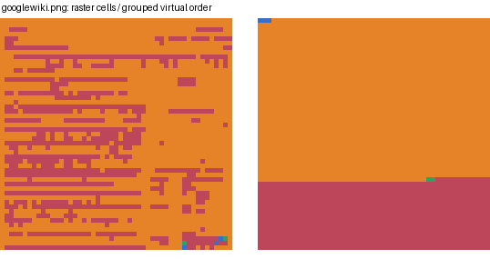
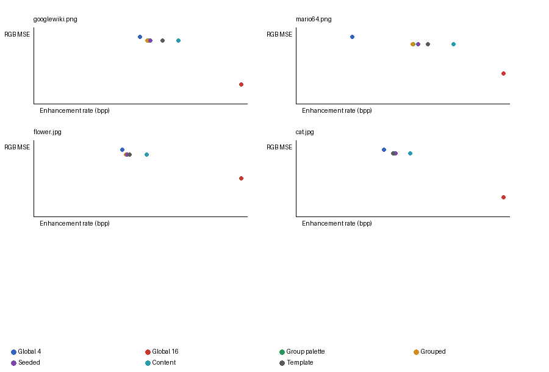

# PBC V4: nonlocal grouping and seeded permutations

Pass 29 is a bounded component study. It does not change the PBC codec or claim a V4 codec improvement.

## Frozen setup

- Codec source commit: 7cd75bfac86ea432641bb4d5e09fd84cf84d8b45. Runtime source and model hashes are in PBC_V4_NONLOCAL_GROUPING_SUMMARY.json.
- Each base uses PBC 3.1 Quality, release RNG and default preset settings. It is encoded once, independently decoded, and held fixed. Original-resolution signed RGB residuals use int16 subtraction. The exact stream is retained locally with its hash; base-encode duration was not retained, and no base timing comparison is claimed.
- Runtime measurements are local Windows 10, Python 3.11.16, Intel64 Family 6 Model 154 Stepping 3, GenuineIntel, 20 logical CPUs, with Numba/BLAS/OpenMP constrained to one thread. No HF timing was run.
- Inputs: googlewiki.png (text), mario64.png (synthetic graphics), flower.jpg (smooth photography) and cat.jpg (detailed photography). Source hashes, base stream sizes and base SHA-256 values are recorded per image.
- Grid: nonoverlapping 16x16 cells. Partial cells are zero-padded in packed indices and cropped on restoration. Four groups use deterministic Lloyd clustering, farthest-first initialization and canonical center ordering.
- Distribution descriptors are mean RGB residual, per-channel variance and an eight-bin signed luminance histogram. Structure descriptors add mean absolute horizontal and vertical residual gradients and their magnitude. Group IDs are transmitted at two bits per cell.
- Palette fitting uses deterministic stride sampling capped at 65,536 residual pixels per palette, farthest-first initialization, Lloyd updates, signed int16 RGB centers and nearest squared-RGB indices. Controls use global palettes of 4 and 16 entries; grouped coding uses four entries per group.
- Distortion is original-resolution RGB MSE after adding the quantized correction to the decoded base and clipping to 0..255. Edge and smooth diagnostics use the strongest 10% and lowest-gradient 50% of source pixels.
- Index streams use XZ/LZMA preset 6. Complete size includes header, group map, palette, packed indices, XZ stream, seed signal and ordering map.
- Seed PRNG is xorshift64* with 64-bit wraparound and multiplier 0x2545F4914F6CDD1D. Initial per-group state is ((seed_index+1)*0x9E3779B97F4A7C15 + (group+1)*0xD1B54A32D192ED03) mod 2^64, with a fixed nonzero replacement for zero. Descending Fisher-Yates uses j = output mod (i+1). Enumeration is seed index 0..N-1; fixed test vectors are in test_experiment.py.
- The positioning idea follows PBC V2.3's get_stroke_params in PBC2_3.py at commit 9a7f2551ccf0e4f66a943de5666aeaa6509b84c1, which used RandomState(seed) for stroke row and column. This experiment defines its own PRNG and cell shuffle.

## Complete-file results

Seed and content reorderings use frozen grouped indices, so their reconstruction distortion is identical within each image. Base plus grouped-virtual bytes include the unchanged PBC stream.

| Image / class | Base B | Global-4 B / MSE | Global-16 B / MSE | Group palette raster B / MSE | Grouped virtual B / MSE | Virtual bpp | Best searched seed B | Content map sent B | Template B | Base + virtual B |
|---|---:|---:|---:|---:|---:|---:|---:|---:|---:|
| googlewiki.png / text | 82,440 | 38,830 / 228.19 | 75,462 / 67.76 | 42,001 / 215.92 | 41,305 / 215.92 | 0.4999 | 42,542 | 52,609 | 46,866 | 123,745 |
| mario64.png / synthetic graphics | 64,809 | 23,438 / 79.62 | 86,186 / 36.38 | 48,678 / 71.12 | 48,594 / 71.12 | 0.3906 | 50,779 | 65,410 | 54,979 | 113,403 |
| flower.jpg / smooth photography | 28,979 | 572,846 / 20.56 | 1,338,050 / 11.86 | 599,938 / 19.20 | 597,042 / 19.20 | 0.5603 | 605,170 | 731,630 | 621,611 | 626,021 |
| cat.jpg / detailed photography | 63,297 | 785,434 / 55.41 | 1,844,910 / 16.41 | 870,978 / 52.64 | 866,166 / 52.64 | 0.8128 | 887,427 | 1,015,030 | 866,419 | 929,463 |

Equal-weight means: global-4 355,137 B / MSE 95.95; grouped palette raster 390,399 B / MSE 89.72; grouped virtual 388,277 B / MSE 89.72; global-16 836,152 B / MSE 33.10. This small content screen is not a population estimate.

### Ordering and seed search

| Image | Group-palette raster B | Grouped virtual B | Net reduction | Best budget / seed | Best seeded B / index bits | Seed penalty | Content upper bound without map | Content complete B |
|---|---:|---:|---:|---:|---:|---:|---:|---:|
| googlewiki.png | 42,001 | 41,305 | 1.66% | 16 / 11 | 42,542 / 4 | +2.99% | 42,205 | 52,609 |
| mario64.png | 48,678 | 48,594 | 0.17% | 16 / 12 | 50,779 / 4 | +4.50% | 49,858 | 65,410 |
| flower.jpg | 599,938 | 597,042 | 0.48% | 1 / 0 | 605,170 / 0 | +1.36% | 598,126 | 731,630 |
| cat.jpg | 870,978 | 866,166 | 0.55% | 256 / 187 | 887,427 / 8 | +2.45% | 881,526 | 1,015,030 |

The content upper bound omits the cell-position map and is not a valid file. Complete content ordering sends four raw bytes per cell. Candidate budgets identify an index with 0, 4, 6 or 8 bits; nonzero seed fields occupy one byte in the container, with padding counted.

The seed table records bytes and selected seed for both distribution and distribution-plus-structure grouping. Proxy scoring covers the first N seeds at each budget; actual XZ coding checks only the three proxy leaders plus up to two fixed enumeration probes. Rank correlations use this small sample.

| Image | Grouping | 1 seed B/index | 16 seeds B/index | 64 seeds B/index | 256 seeds B/index | Proxy at 256 | Coded probes at 256 | Rank correlation |
|---|---|---:|---:|---:|---:|---:|---:|---:|
| googlewiki.png | distribution | 43,033/0 | 42,934/2 | 42,906/35 | 42,898/110 | 0.001/0.004/0.015/0.057s | 0.295s | 1.00 |
| googlewiki.png | distribution+structure | 42,641/0 | 42,542/11 | 42,578/20 | 42,554/255 | 0.000/0.004/0.017/0.066s | 0.341s | 0.00 |
| mario64.png | distribution | 59,438/0 | 59,431/10 | 59,423/21 | 59,403/185 | 0.001/0.008/0.031/0.103s | 0.506s | -0.60 |
| mario64.png | distribution+structure | 50,838/0 | 50,779/12 | 50,779/12 | 50,783/119 | 0.001/0.005/0.017/0.074s | 0.450s | 0.50 |
| flower.jpg | distribution | 601,154/0 | 601,039/12 | 600,919/31 | 600,923/84 | 0.002/0.021/0.067/0.198s | 6.330s | 0.10 |
| flower.jpg | distribution+structure | 605,170/0 | 605,171/0 | 605,171/0 | 605,171/0 | 0.001/0.010/0.054/0.215s | 6.830s | 0.10 |
| cat.jpg | distribution | 913,438/0 | 913,211/2 | 913,211/2 | 913,211/2 | 0.002/0.024/0.082/0.291s | 3.933s | 0.50 |
| cat.jpg | distribution+structure | 887,470/0 | 887,471/0 | 887,471/0 | 887,427/187 | 0.001/0.017/0.067/0.337s | 4.402s | -0.10 |

Structured-group cell counts (group IDs 0 through 3) show imbalance: googlewiki.png: 3,1819,2,777; mario64.png: 3237,634,13,4; flower.jpg: 1,28,32723,624; cat.jpg: 15,26,20674,12661.

### Runtime

| Image | Features | Clustering | Palette fit | 256-seed proxy | Full research pass | Virtual encode median | Virtual decode median |
|---|---:|---:|---:|---:|---:|---:|---:|
| googlewiki.png | 0.217s | 0.021s | 1.462s | 0.066s | 13.27s | 0.045s | 0.045s |
| mario64.png | 0.449s | 0.030s | 1.772s | 0.074s | 16.57s | 0.072s | 0.050s |
| flower.jpg | 3.607s | 0.232s | 2.655s | 0.215s | 163.16s | 1.109s | 0.424s |
| cat.jpg | 3.364s | 0.439s | 2.904s | 0.337s | 127.16s | 0.682s | 0.485s |

Representation timings use one warm-up plus three single-threaded runs and report medians. Full research-pass time includes decoding the saved base, search, palette fitting, all controls and validation; it is not the time to encode one selected enhancement. Component byte breakdowns, timing samples, edge/smooth distortion and peak traced allocations are in the JSON summary. Peak traced allocation is a process high-water measure.

Group4 palettes cost 96 bytes total; global-4 costs 24 bytes and global-16 costs 96 bytes. The 2-bit assignment map is ceil(cell_count*2/8) bytes. Content ordering adds 4*cell_count raw mapping bytes. The template stores 256 representative index bytes plus XZ-coded two-bit modular differences. Each summary row also gives base-plus-enhancement bytes and bpp.

## Failure analysis

The group map itself is a small, counted cost; the larger losses come from weak and sometimes highly unbalanced clusters, increased index entropy after group-specific palettes, and the raw map required by content-informed order. Grouping only marginally improves XZ size when indices are frozen. Seeded permutations change local adjacency but do not give LZMA a better global context. The shared-template deltas do not create enough repeated zero structure to repay the representatives and map. Quantization remains the dominant rate-distortion choice: global-16 reaches much lower error at substantially higher rate, while four shared entries keep size down with higher error.

## Conclusions

A. Group-contiguous cells reduce complete lossless size by 0.17-1.66% versus original raster order with the same assignments, palettes and indices. This misses the 3% screen on all images. The current clusters are highly unbalanced.

B. Seeded permutations do not produce useful savings after signaling. The best sampled files are 1.36-4.50% larger than deterministic grouped order for every image. A 256-candidate budget does not rescue the rate.

C. Best sampled seeds are within 0.67-1.85% of the content-order no-map upper bound. That arrangement is not decodable without its map. Complete content-order files are 17.2-34.6% larger than grouped order.

D. Shared-template coding costs 0.03-13.46% more than virtual coding. Cat is effectively tied, with added representative/difference reconstruction work.

E. Group-specific palettes lower MSE by 5.0-10.7% versus global-4 while increasing rate by 4.7-107.7%. Compared with global-16, grouped files are smaller but have much higher MSE. This is a rate-distortion trade.

F. Virtual-order savings by class are text 1.66%; synthetic graphics 0.17%; smooth photography 0.48%; detailed photography 0.55%. Four images do not establish class-wide generalization.

G. Stop expanding seed search. The only mechanism that merits a narrow second pass is balanced deterministic grouping: virtual order reduced bytes on all four inputs, but stayed below the screen and current groups are highly unbalanced. Keep the four-image scope and stop if complete files do not improve. No architecture change is justified yet.

H. A learned encoder action remains a hypothesis. This pass computes descriptors and groups but does not train or evaluate a learned policy.

The findings above use complete files, counted side information, exact index/position restoration, full RGB reconstruction and fresh-process decoding. The content-order upper bound and learned-action idea remain diagnostics or hypotheses.

## Correctness and reproduction

The five unittest groups cover PRNG vectors, 2/4-bit packing, signed residuals, partial cells, all-zero/constant values, three virtual orderings, shared templates, malformed/truncated/trailing data and fresh-process decoding of both containers. Actual file decodes reproduce the reported original-resolution MSE.

From repository root with the pinned research environment: run research_pass29/experiment.py, then research_pass29/experiment.py --refresh-decode-timings, then research_pass29/summarize.py. Generated bases, arrays and raw output stay in ignored research_pass29/outputs/.

