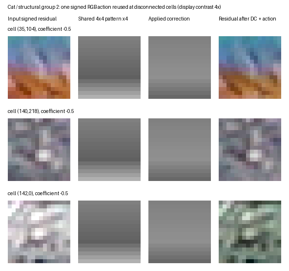

# PBC V4 Pass 30: shared-action feasibility

## Result

Phase A failed its stop gate. The four-pattern residual-shape fit cleared the 10% residual-SSE screen on only Cat, one of four content classes. Its 12.57% reduction beyond DC used all four patterns at multiple cells. The other classes reached 4.83% (Flower), 1.93% (Mario64) and 0.20% (Googlewiki). Phase B was not run: no enhancement streams, XZ sizes, rate-distortion points, or file-only decoder were built.

The independent 4x4-cell control reduced residual SSE more on every image, including 24.09% on Cat at q=8. That control is not a rate comparison; its active-cell payload could be much larger. Pass 30 therefore shows a narrow approximation opportunity, but no evidence that sharing saves bits. Stop this mechanism here.

## Frozen setup

- Starting branch and commit: `research/experiments`, `9d0bc00fbc5e7a2d7bb21596dc02574705f7bb5a`.
- Inputs and decoded PBC V3.1 Quality/release-RNG bases are the cached Pass 29 artifacts. The bases were held fixed; no PBC encoding was repeated.
- Source residual: signed int16 `original RGB - independently decoded base RGB`; original-resolution dimensions and EXIF orientation are preserved.
- Grid: nonoverlapping 16x16 cells, zero-padded at partial boundaries and cropped to the image at reconstruction.
- Shared pattern: signed RGB 4x4 grid, bilinearly interpolated to 16x16. Pattern values are rounded away from zero to multiples of q, with q in `{8,16}`. The same two settings were used for the independent-cell control.
- Coefficients, ordered by code, are `{-2,-1,-0.5,0,0.5,1,2}`. Code 3 is zero. DC is a per-cell RGB mean quantized to multiples of 8 and clipped to [-256,256]. DC treatment is identical for shared and independent controls.
- Four-pattern Pass 29 grouping reuses the frozen distribution-plus-structure assignments. The alternate grouping clusters normalized 4x4 luminance residual shape with deterministic farthest-first Lloyd updates, four groups, and no balancing.
- Four fitting rounds choose from the quantized coefficient alphabet and update the quantized patterns. Final MSE and SSE use those quantized patterns and exact decoder-equivalent interpolation, coefficient application, canvas clipping and RGB rounding. The separate ideal-coefficient diagnostic uses continuous bounded coefficients and is not transmitted.
- Image classes: Googlewiki (text), Mario64 (synthetic graphics), Flower (smooth photography), Cat (detailed photography). Main source hashes and base-stream hashes/sizes are in `outputs/phase_a.json` and the Pass 29 result manifest.

## Phase A

MSE is original-resolution RGB MSE after applying the fixed base, DC, and candidate correction. Residual-SSE reduction is measured against the same image's DC-only signed residual SSE before canvas clipping. “Ideal” uses unpriced continuous coefficients on the fitted quantized pattern.

| Image / class | Base MSE | DC-only MSE | Shared-shape q=8 MSE / SSE reduction | Ideal coefficient SSE reduction | Active cells (q=8) | Independent q=8 MSE / SSE reduction |
|---|---:|---:|---:|---:|---:|---:|
| Googlewiki / text | 781.03 | 777.28 | 774.82 / 0.20% | 0.52% | 1,108 | 762.12 / 1.87% |
| Mario64 / synthetic | 135.47 | 128.25 | 125.69 / 1.93% | 2.33% | 541 | 110.56 / 13.76% |
| Flower / smooth photo | 43.43 | 30.86 | 29.30 / 4.83% | 7.01% | 1,866 | 17.39 / 43.46% |
| Cat / detailed photo | 299.19 | 287.30 | 251.16 / 12.57% | 14.29% | 13,892 | 218.00 / 24.09% |

Cat q=8 group sizes are `[7786, 5306, 14548, 5736]`; active cells per pattern are `[3012, 5228, 2367, 3285]`. Thus the Cat result is reused across thousands of spatially separated cells rather than coming from one large connected region. The screen still fails the two-class requirement.

The complete fixed q screen is below. Every row reports actual quantized-candidate MSE, the signed residual-SSE reduction beyond DC, and active cells. For independent coding, active cells are those whose quantized 4x4 grid lowers exact per-cell SSE compared with DC alone.

| Image | Method | q | RGB MSE | Residual-SSE reduction beyond DC | Active cells |
|---|---|---:|---:|---:|---:|
| Googlewiki | Global shared | 8 | 775.98 | 0.07% | 986 |
| Googlewiki | Global shared | 16 | 776.17 | 0.06% | 772 |
| Googlewiki | Pass 29 groups | 8 | 775.68 | 0.18% | 846 |
| Googlewiki | Pass 29 groups | 16 | 775.90 | 0.09% | 596 |
| Googlewiki | Residual-shape groups | 8 | 774.82 | 0.20% | 1,108 |
| Googlewiki | Residual-shape groups | 16 | 775.67 | 0.09% | 693 |
| Googlewiki | Independent cells | 8 | 762.12 | 1.87% | 1,713 |
| Googlewiki | Independent cells | 16 | 765.35 | 1.38% | 1,234 |
| Mario64 | Global shared | 8 | 127.48 | 0.56% | 345 |
| Mario64 | Global shared | 16 | 127.52 | 0.56% | 259 |
| Mario64 | Pass 29 groups | 8 | 126.85 | 1.05% | 860 |
| Mario64 | Pass 29 groups | 16 | 127.55 | 0.50% | 381 |
| Mario64 | Residual-shape groups | 8 | 125.69 | 1.93% | 541 |
| Mario64 | Residual-shape groups | 16 | 126.49 | 1.39% | 420 |
| Mario64 | Independent cells | 8 | 110.56 | 13.76% | 3,531 |
| Mario64 | Independent cells | 16 | 115.23 | 9.72% | 2,029 |
| Flower | Global shared | 8 | 29.82 | 3.20% | 1,317 |
| Flower | Global shared | 16 | 29.99 | 2.57% | 767 |
| Flower | Pass 29 groups | 8 | 29.54 | 4.09% | 4,172 |
| Flower | Pass 29 groups | 16 | 29.87 | 3.02% | 1,806 |
| Flower | Residual-shape groups | 8 | 29.30 | 4.83% | 1,866 |
| Flower | Residual-shape groups | 16 | 29.53 | 3.97% | 1,279 |
| Flower | Independent cells | 8 | 17.39 | 43.46% | 30,112 |
| Flower | Independent cells | 16 | 21.63 | 29.61% | 6,192 |
| Cat | Global shared | 8 | 264.89 | 7.79% | 10,680 |
| Cat | Global shared | 16 | 261.59 | 8.90% | 11,330 |
| Cat | Pass 29 groups | 8 | 264.72 | 7.85% | 11,295 |
| Cat | Pass 29 groups | 16 | 261.52 | 8.93% | 11,544 |
| Cat | Residual-shape groups | 8 | 251.16 | 12.57% | 13,892 |
| Cat | Residual-shape groups | 16 | 254.03 | 11.58% | 13,808 |
| Cat | Independent cells | 8 | 218.00 | 24.09% | 30,225 |
| Cat | Independent cells | 16 | 223.92 | 22.00% | 21,002 |

Residual-shape grouping improves on Pass 29 assignments at both q values for all four images. The largest measured gap is Cat: q=8 reduces MSE from 264.72 to 251.16 and raises residual-SSE reduction from 7.85% to 12.57%. The structural clusters are more balanced than Pass 29's on these data, but grouping still does not close the approximation gap to independent cells.

## Phase B and signaling

Phase B was intentionally stopped by the gate. There are no completed enhancement files or actual byte costs, so there is no measured bpp, total base-plus-enhancement size, rate match, entropy payload, or shared-versus-independent RD result. The base stream sizes alone are 82,440 B (Googlewiki), 64,809 B (Mario64), 28,979 B (Flower), and 63,297 B (Cat); these do not include a Pass 30 enhancement.

For scale only, the frozen proposal would have nominal uncompressed fields before shared XZ: 96 B per shared int16 4x4 RGB pattern (96 B global, 384 B for four patterns); `ceil(2N/8)` B for a four-group map; `ceil(3N/8)` B for coefficient symbols; and `3N` B for quantized per-cell DC. The independent control would add an `ceil(N/8)` activation map and 48 B per active cell, plus the same DC. These are design arithmetic, not measured costs; no XZ coding or complete-file comparison was run. Pattern, map, coefficient, activation, DC and entropy byte breakdowns remain unmeasured.

## Runtime and resource observations

The final timing screen used Python 3.13.5, NumPy 2.2.6, Pillow 11.3.0 on Windows 11, Intel64 Family 6 Model 154 Stepping 3, with numerical thread pools limited to one. Each timing has one warm-up followed by three repetitions; samples and thread-pool metadata are in `outputs/timing.json`.

| Image | Pattern fit median | Decoder-equivalent reconstruction median | Peak process working set |
|---|---:|---:|---:|
| Googlewiki | 0.015 s | 0.032 s | 115 MB |
| Mario64 | 0.023 s | 0.036 s | 136 MB |
| Flower | 0.460 s | 0.281 s | 603 MB |
| Cat | 0.419 s | 0.416 s | 603 MB |

Fit timing covers only the four alternating fit rounds for residual-shape groups at q=8. It excludes residual preparation, feature extraction/clustering, DC fitting, stream creation, and compression. Reconstruction timing applies the already-fitted DC/pattern/coefficient arrays to the base; it excludes parsing or entropy decoding because no serialized format was built. Peak working set is the process high-water mark, not a per-image allocation delta. It is memory-heavy for the two 8.5-megapixel photos and does not support a claim of bounded-memory decoding.

The visualization uses the actual Cat residual and fitted group-2 pattern. Signed values use a labeled 4x display contrast so the low-amplitude correction remains visible.



## Correctness and limitations

Three focused tests pass: signed half-away rounding and deterministic bilinear interpolation; quantized signed patterns and coefficient symbols; and disconnected assignments plus a partial-boundary reconstruction. The fitted RGB MSE is computed after exact reconstruction and clipping. Saved fit arrays were reloaded to create the visualization.

The independent validation pass reloaded all four images and all six shared-action candidates per image from the saved fit arrays. All 24 reconstructions were deterministic and reproduced their stored RGB MSE within `1e-4`; hashes are in ignored `outputs/validation.json`. The unit tests are in `test_phase_a.py`.

No Phase B stream existed, so file-only decoding, malformed/truncated stream rejection, entropy payload round trips, and decoder behavior in a fresh process were not tested. Those requirements are not claimed as passed. The stop decision avoids building that format after the Phase A gate failed.

Reproduction from the repository root uses the cached Pass 29 assets:

```powershell
python research_pass30/phase_a.py
python research_pass30/timing_phase_a.py
python research_pass30/summarize_phase_a.py
python research_pass30/validate_phase_a.py
python -B -m unittest -v test_phase_a.py  # from research_pass30/
```

Generated arrays, timing samples, compact raw rows and validation hashes remain under ignored `outputs/`.

## Conclusions

**A.** A shared action can approximate multiple disconnected regions in the Cat residual: the best candidate explains 12.57% of post-DC residual SSE and is reused in all four groups. This is a single detailed-photo result; text, graphics and smooth-photo results stay below 5%.

**B.** Quantized spatial patterns add 0.20%, 1.93%, 4.83%, and 12.57% residual-SSE reduction beyond DC for text, graphics, smooth photo and detailed photo. Continuous unpriced coefficients raise these only to 0.52%, 2.33%, 7.01%, and 14.29%; the ideal diagnostic does not rescue other classes.

**C.** Residual-shape groups improve approximation over Pass 29's distribution-plus-structure assignments on all four images. They do not meet the gate on three of four classes.

**D.** Actual pattern, membership, coefficient, activation, DC and entropy bytes were not measured. The nominal uncompressed field formulas are listed above; no bitrate claim follows from them.

**E.** Actual RD versus independent cells is unknown because Phase B was not run. In the equal-q approximation screen, independent grids lower residual SSE more on all images and lower Cat MSE by another 33.16 points versus the best shared action. Sharing has not demonstrated an RD advantage.

**F.** Detailed photography is the only class that passes the representational screen. Flower, text and synthetic graphics show smaller improvements.

**G.** The operations are simple (bilinear interpolation, scalar multiply, addition and clipping), but reconstruction takes 0.28–0.42 s for the photo inputs in this prototype and the process peak reaches 603 MB. A practical serialized decoder was not measured.

**H.** A learned chooser is not justified by these results. Deterministic fitting already exposes the narrow case where sharing helps, and a model cannot recover the missing class-wide reuse or overcome independent cells' much better approximation without an actual rate advantage.

Move to a different representation. The existing Pass 26 recommendation—a full-resolution heterogeneous region tree with mutually exclusive smooth-surface and local-detail modes—is a more suitable next architectural direction than adding more shared patterns or groups. This result does not start Pass 31.
