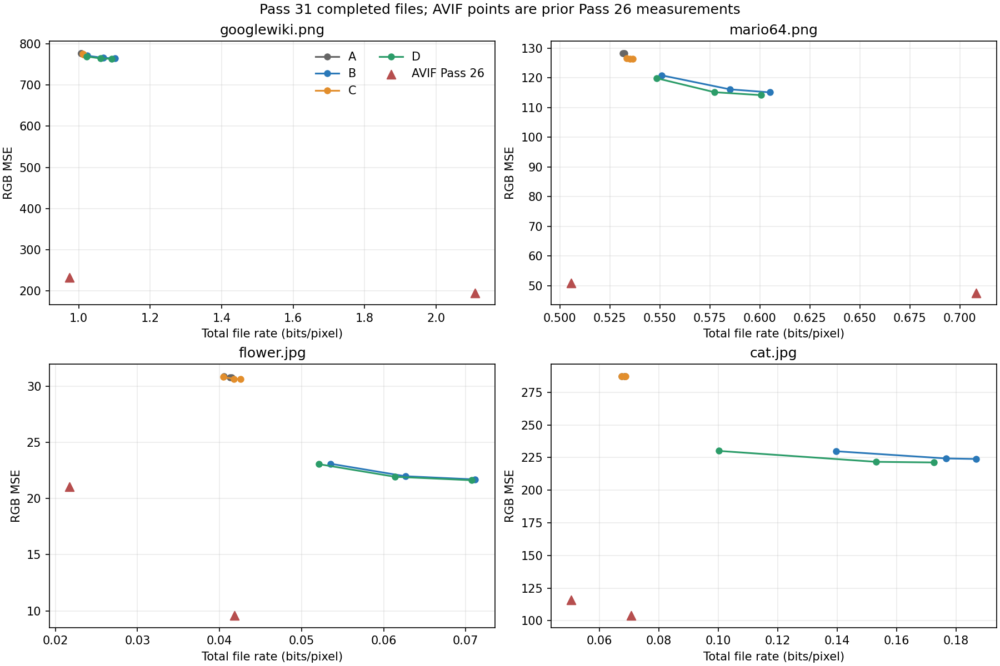
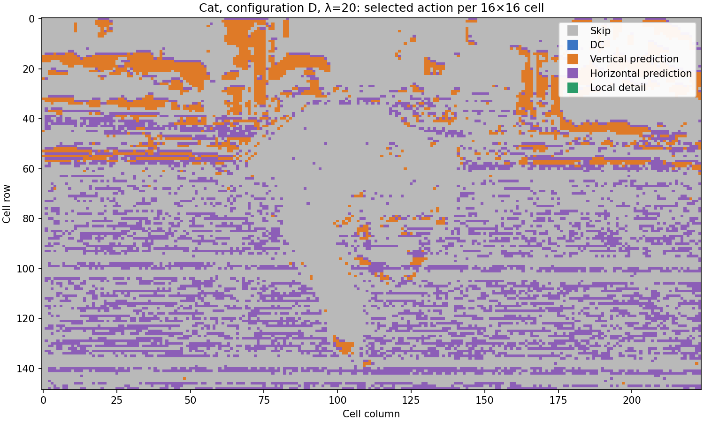

# PBC V4 Pass 31 — Fixed-Grid Predictive Refinement Results

## Result

The fixed-grid refinement is decodable and produces complete enhancement files, but the screen does not support adopting it as a general PBC architecture. Local detail improves reconstruction when the stream is allowed to grow substantially. The combined adaptive configuration (D) is useful on the detailed cat image: at lambda 20 it is 13.3% smaller than detail-only B at slightly lower MSE. On the other images its gains over B are small. Direction-only C stays close to the simple DC control A. No configuration approaches the selected Pass 26 AVIF points on these four inputs.

## Representation and frozen setup

Each source uses its existing Pass 29 PBC V3.1 Quality stream and independently decoded RGB base. The base is held fixed for all 12 candidates per image. A 16×16 raster grid handles partial boundary cells. Residual predictors carry reconstructed signed RGB residuals from the prior cell row/column: the last decoded pixel row is extended vertically, and the last decoded pixel column horizontally. Actual clipped reconstructed pixels update predictor state. Top/left unavailable directions are excluded.

Modes are mutually exclusive: 0 skip; 1 one signed RGB DC vector quantized at step 8; 2 vertical; 3 horizontal; 4 signed 4×4 RGB detail grid quantized at step 16; 5 vertical plus a step-8 RGB offset; 6 horizontal plus a step-8 RGB offset. Detail interpolation is align-corners bilinear on a 16×16 cell, fixed-point with ties away from zero, then base addition and RGB clipping. Configs A/B/C/D enable {0,1}/{0,1,4}/{0,1,2,3,5,6}/{0..6}.

Candidate choice minimizes exact clipped local RGB SSE plus lambda times a fixed estimated rate: 3 bits skip, 27 DC, 3 directional without offset, 27 directional with offset, 387 detail. Lambdas are frozen at 0, 20 and 100 after the documented single-image calibration. These estimates are only for mode choice. Mode symbols (3-bit packed) and parameters are concatenated, then compressed once per file with XZ/LZMA preset 6. The 31-byte header and all XZ framing are included in enhancement bytes. Total bytes are frozen PBC base bytes plus complete enhancement file bytes.

## Provenance and correctness

| Image | Class | Dimensions | Base bytes | Source RGB SHA-256 | Decoded base RGB SHA-256 | Base MSE |
|---|---|---:|---:|---|---|---:|
| googlewiki.png | text | 814×812 | 82,440 | `cb2cc48d6a03b603d217b59fc4a3d3e53c6bebdff09e0a8172640bf85ccde94e` | `0f4f38e879741604d1a80ff1c47e3130629409dcf8544c05d1fbbe3a9561281a` | 781.029 |
| mario64.png | synthetic graphics | 1152×864 | 64,809 | `19e195de8f46fc4c4ef19925461c21da5769d682b152c967a783d5d3868c00d9` | `ae2187db7cb5844eed6195335873a40b03e8843ed35bcbf8bb6e7a4a1fc310e1` | 135.472 |
| flower.jpg | smooth photography | 3576×2384 | 28,979 | `a8a33c44cfaf9b251d896181d55e30a8bd1e53fa41574c8f75b74950d73f2f72` | `4da27ce250bf5020d2220f21766928b02b20766ac9933a62715864a80563190e` | 43.435 |
| cat.jpg | detailed photography | 3576×2384 | 63,297 | `75482650c75b9fc17f4ee2f40b093a6065ca9103216650df5da4dbd492915c4e` | `a4e1756ebae5e0ea61cf1dc9601565a6728a80a3388b24b09c3aed569110ac27` | 299.192 |

The run started at `fa86060175889e8ec40d3dd3b938b7982daa93dd` on Python 3.13.5, NumPy 2.2.6, Pillow 11.3.0, Windows 11, Intel64 Family 6 Model 154, with BLAS limited to one thread. Base stream byte sizes and independently decoded base hashes were checked against the Pass 29 provenance; source/base dimensions match.

`python -B -m unittest test_pbc31_codec -v` from `research_pass31/` passes 7 tests: bit packing/fixed-point interpolation, odd signed dimensions and boundary eligibility, reconstructed-neighbor prediction, constant/gradient/edge/text-like fixtures, clipping, malformed/truncated streams, and fresh-process file-only decoding. The four-image screen produced 48 complete enhancement files; every file was decoded in a fresh worker process and its output pixel, mode, and parameter hashes matched the encoder record.

## Complete-file results

Each row reports `enhancement bytes / total bytes`, total RGB bpp, final RGB MSE, strong-edge top-decile MSE / smooth bottom-half MSE, encode / warmed median decode seconds, and mode counts `[S, DC, V, H, Detail, V+DC, H+DC]`. Lower MSE and smaller total bytes are preferred. The full exact records, hashes, timing samples, rate accounting and per-mode SSE diagnostics are in [the JSON summary](PBC_V4_PREDICTIVE_REFINEMENT_SUMMARY.json).

### Googlewiki — text (base MSE 781.03)

| Config | λ | Enhance / total B | Total bpp | MSE (edge / smooth) | Encode / decode s | Modes `[S,DC,V,H,D,V+DC,H+DC]` |
|---|---:|---:|---:|---:|---:|---|
| A | 0 | 767 / 83,207 | 1.0071 | 777.24 (3741.9 / 62.6) | 0.167 / 0.038 | `2048,553,0,0,0,0,0` |
| A | 20 | 759 / 83,199 | 1.0070 | 777.24 (3741.9 / 62.6) | 0.169 / 0.038 | `2052,549,0,0,0,0,0` |
| A | 100 | 743 / 83,183 | 1.0068 | 777.25 (3741.9 / 62.6) | 0.167 / 0.037 | `2067,534,0,0,0,0,0` |
| B | 0 | 8,527 / 90,967 | 1.1010 | 764.75 (3694.0 / 57.6) | 0.503 / 0.140 | `1054,174,0,0,1373,0,0` |
| B | 20 | 5,927 / 88,367 | 1.0695 | 765.82 (3707.1 / 57.3) | 0.575 / 0.125 | `1534,306,0,0,761,0,0` |
| B | 100 | 2,091 / 84,531 | 1.0231 | 771.24 (3734.5 / 59.0) | 0.685 / 0.063 | `1998,476,0,0,127,0,0` |
| C | 0 | 1,227 / 83,667 | 1.0127 | 774.89 (3724.4 / 60.9) | 0.675 / 0.071 | `616,304,880,626,0,107,68` |
| C | 20 | 1,183 / 83,623 | 1.0121 | 774.92 (3724.6 / 60.9) | 0.749 / 0.068 | `686,260,873,630,0,91,61` |
| C | 100 | 1,123 / 83,563 | 1.0114 | 775.02 (3726.4 / 60.9) | 0.672 / 0.054 | `750,213,880,633,0,75,50` |
| D | 0 | 7,815 / 90,255 | 1.0924 | 763.61 (3688.5 / 56.9) | 1.103 / 0.154 | `666,133,316,258,1155,27,46` |
| D | 20 | 5,239 / 87,679 | 1.0612 | 764.57 (3698.9 / 56.3) | 0.977 / 0.109 | `723,183,575,451,568,51,50` |
| D | 100 | 2,079 / 84,519 | 1.0230 | 769.05 (3717.5 / 57.4) | 0.999 / 0.062 | `690,194,870,641,83,72,51` |

### Mario64 — synthetic graphics (base MSE 135.47)

| Config | λ | Enhance / total B | Total bpp | MSE (edge / smooth) | Encode / decode s | Modes `[S,DC,V,H,D,V+DC,H+DC]` |
|---|---:|---:|---:|---:|---:|---|
| A | 0 | 1,407 / 66,216 | 0.5322 | 128.25 (946.2 / 27.5) | 0.308 / 0.095 | `2559,1329,0,0,0,0,0` |
| A | 20 | 1,391 / 66,200 | 0.5321 | 128.25 (946.2 / 27.5) | 0.335 / 0.086 | `2584,1304,0,0,0,0,0` |
| A | 100 | 1,299 / 66,108 | 0.5313 | 128.30 (946.1 / 27.5) | 0.333 / 0.072 | `2686,1202,0,0,0,0,0` |
| B | 0 | 10,463 / 75,272 | 0.6050 | 115.11 (889.9 / 18.5) | 0.852 / 0.214 | `1456,425,0,0,2007,0,0` |
| B | 20 | 7,979 / 72,788 | 0.5850 | 116.13 (891.9 / 19.2) | 0.847 / 0.167 | `2106,694,0,0,1088,0,0` |
| B | 100 | 3,719 / 68,528 | 0.5508 | 120.85 (914.3 / 21.6) | 0.834 / 0.097 | `2618,948,0,0,322,0,0` |
| C | 0 | 1,939 / 66,748 | 0.5365 | 126.37 (941.1 / 25.3) | 0.847 / 0.074 | `1713,813,376,629,0,189,168` |
| C | 20 | 1,771 / 66,580 | 0.5351 | 126.38 (941.1 / 25.3) | 0.881 / 0.090 | `1778,513,482,837,0,140,138` |
| C | 100 | 1,567 / 66,376 | 0.5335 | 126.52 (941.0 / 25.6) | 0.909 / 0.066 | `1962,419,479,842,0,90,96` |
| D | 0 | 9,927 / 74,736 | 0.6007 | 114.17 (887.4 / 17.4) | 1.401 / 0.207 | `995,330,281,532,1583,74,93` |
| D | 20 | 7,027 / 71,836 | 0.5774 | 115.16 (888.7 / 18.2) | 1.430 / 0.164 | `1441,312,452,771,704,90,118` |
| D | 100 | 3,431 / 68,240 | 0.5485 | 119.86 (910.2 / 20.7) | 1.371 / 0.086 | `1921,362,480,775,166,81,103` |

### Flower — smooth photography (base MSE 43.43)

| Config | λ | Enhance / total B | Total bpp | MSE (edge / smooth) | Encode / decode s | Modes `[S,DC,V,H,D,V+DC,H+DC]` |
|---|---:|---:|---:|---:|---:|---|
| A | 0 | 15,239 / 44,218 | 0.0415 | 30.79 (196.7 / 10.8) | 2.484 / 0.774 | `13610,19766,0,0,0,0,0` |
| A | 20 | 15,011 / 43,990 | 0.0413 | 30.80 (196.7 / 10.8) | 2.485 / 0.875 | `14213,19163,0,0,0,0,0` |
| A | 100 | 14,183 / 43,162 | 0.0405 | 30.93 (196.9 / 10.9) | 2.591 / 0.695 | `16444,16932,0,0,0,0,0` |
| B | 0 | 46,795 / 75,774 | 0.0711 | 21.71 (123.4 / 9.5) | 7.288 / 1.185 | `11859,16220,0,0,5297,0,0` |
| B | 20 | 37,771 / 66,750 | 0.0626 | 22.00 (124.2 / 9.7) | 7.135 / 1.076 | `13398,17231,0,0,2747,0,0` |
| B | 100 | 28,031 / 57,010 | 0.0535 | 23.11 (129.9 / 10.2) | 7.494 / 0.790 | `16087,16056,0,0,1233,0,0` |
| C | 0 | 16,347 / 45,326 | 0.0425 | 30.67 (196.3 / 10.7) | 7.629 / 0.852 | `12497,19057,701,500,0,343,278` |
| C | 20 | 15,547 / 44,526 | 0.0418 | 30.68 (196.4 / 10.7) | 7.832 / 0.681 | `12983,8111,7101,4749,0,232,200` |
| C | 100 | 14,139 / 43,118 | 0.0405 | 30.83 (196.6 / 10.9) | 8.469 / 0.705 | `14426,6421,7401,4875,0,134,119` |
| D | 0 | 46,399 / 75,378 | 0.0707 | 21.64 (122.9 / 9.5) | 14.870 / 1.266 | `11561,16054,249,239,5044,102,127` |
| D | 20 | 36,459 / 65,438 | 0.0614 | 21.95 (123.8 / 9.7) | 14.024 / 1.008 | `12724,6935,6583,4387,2476,112,159` |
| D | 100 | 26,531 / 55,510 | 0.0521 | 23.08 (129.7 / 10.2) | 13.611 / 0.918 | `14302,5886,7166,4725,1103,84,110` |

### Cat — detailed photography (base MSE 299.19)

| Config | λ | Enhance / total B | Total bpp | MSE (edge / smooth) | Encode / decode s | Modes `[S,DC,V,H,D,V+DC,H+DC]` |
|---|---:|---:|---:|---:|---:|---|
| A | 0 | 9,819 / 73,116 | 0.0686 | 287.29 (849.5 / 83.5) | 2.652 / 0.713 | `19438,13938,0,0,0,0,0` |
| A | 20 | 9,563 / 72,860 | 0.0684 | 287.30 (849.5 / 83.5) | 2.538 / 0.732 | `20069,13307,0,0,0,0,0` |
| A | 100 | 8,559 / 71,856 | 0.0674 | 287.42 (849.5 / 83.7) | 2.614 / 0.660 | `22251,11125,0,0,0,0,0` |
| B | 0 | 135,775 / 199,072 | 0.1868 | 223.90 (668.4 / 61.6) | 8.377 / 2.524 | `7560,4979,0,0,20837,0,0` |
| B | 20 | 124,895 / 188,192 | 0.1766 | 224.32 (668.3 / 61.9) | 7.884 / 2.195 | `9903,5541,0,0,17932,0,0` |
| B | 100 | 85,435 / 148,732 | 0.1396 | 229.84 (674.0 / 64.5) | 8.079 / 1.728 | `15523,6755,0,0,11098,0,0` |
| C | 0 | 9,891 / 73,188 | 0.0687 | 287.16 (849.3 / 83.3) | 7.984 / 0.733 | `19372,13814,8,121,0,17,44` |
| C | 20 | 10,079 / 73,376 | 0.0689 | 287.17 (849.5 / 83.3) | 7.601 / 0.692 | `19740,5499,4169,3914,0,17,37` |
| C | 100 | 8,647 / 71,944 | 0.0675 | 287.28 (849.7 / 83.4) | 7.805 / 0.712 | `21097,3931,4159,4147,0,12,30` |
| D | 0 | 120,495 / 183,792 | 0.1725 | 221.24 (654.8 / 61.1) | 13.154 / 2.138 | `7506,4953,3,2282,17403,3,1226` |
| D | 20 | 99,855 / 163,152 | 0.1531 | 221.72 (654.5 / 61.4) | 13.039 / 1.986 | `9562,1319,2745,5373,12664,5,1708` |
| D | 100 | 43,487 / 106,784 | 0.1002 | 230.08 (669.0 / 64.8) | 13.028 / 1.113 | `13982,1994,3135,8627,3623,34,1981` |

### Rate-distortion reading

- **Detail versus DC (B versus A):** detail provides large MSE reductions only at substantial extra rate on flower and cat. Mario Bλ100 is 3.5% larger than Aλ0 and lowers MSE 5.8%; Googlewiki Bλ100 is 1.6% larger and lowers MSE 0.8%. These are positive but below the 10% screen. At the flower and cat detail rates there is no close-rate A point, so the large MSE changes are rate-distortion tradeoffs rather than matched-rate wins.
- **Directional/adaptive selection (D versus B):** at λ20, D is 0.8% smaller and 0.2% lower-MSE on Googlewiki, 1.3% smaller and 0.8% lower-MSE on Mario64, 2.0% smaller but 0.2% higher-MSE on flower, and 13.3% smaller and 1.2% lower-MSE on cat. The cat result is a clear local efficiency signal. The same comparison does not show a similarly large general gain across two content classes.
- **Direction-only (C versus A):** effects are small. At λ100, C changes total bytes by +0.5% on Googlewiki, +0.4% on Mario64, −0.1% on flower, and +0.1% on cat; MSE improves by about 0.3%, 1.4%, 0.3%, and 0.05%, respectively. It does not justify direction-only coding by itself.
- **Adaptive mixed modes:** D is strictly better than B at the same λ for all three Mario64 points and the cat λ0/λ20 points on both bytes and MSE. At cat λ100 it uses fewer bytes but has slightly higher MSE. Googlewiki is effectively tied at λ100. Flower D is slightly cheaper but has marginally worse MSE at λ20 and λ100. D’s strongest separation is on detailed photography, where the DC, directional and detail options are selected in different cells.
- **Nondominated points:** the JSON includes exact per-image Pareto flags and tables. The experimental curves remain far from the Pass 26 AVIF reference points. Each selected AVIF point is smaller and lower-MSE than every Pass 31 candidate on its image: Googlewiki AVIF q43 is 80,537 B / MSE 233.15; Mario64 q68 62,909 B / 50.92; flower q18 23,171 B / 21.06; cat q18 53,869 B / 115.91. These are external anchors from Pass 26, not a rerun or a matched-rate codec comparison.

## Mode use and representation contributions

At high rate pressure (λ100), A chooses 534 DC cells on Googlewiki, 1,202 on Mario64, 16,932 on flower, and 11,125 on cat; all other cells skip. Bλ100 chooses 127 / 322 / 1,233 / 11,098 detail cells respectively. Cλ100 selects 1,513 / 1,507 / 12,425 / 8,346 directional cells (including offset variants), showing that direction-only residual prediction is used frequently on smooth flower but rarely helps cat. Dλ100 chooses 1,643 / 1,356 / 12,185 / 13,777 directional cells and 83 / 166 / 1,103 / 3,623 local-detail cells, respectively. The full seven-mode counts for every operating point are in the tables above.

Per-cell SSE diagnostics show selected directional actions can correct meaningful residual energy in D, especially on cat, but mode use alone is not a coding win. In Cat Dλ20, 9,831 directional cells were selected; their selected directional action’s summed SSE gain relative to skip is about 882 million. The best available direction-only opportunity over eligible cells was about 1.51 billion SSE. The selected-mode value is conditional on the encoder’s per-cell competition and its estimated-rate penalty.

## Byte accounting and rate-estimator error

All candidate files have one header, one packed mode stream and one shared XZ stream for parameters; no cell is compressed independently. The 31-byte header and XZ container are included. Raw pre-XZ payload comprises packed modes and parameters. Median actual enhancement bits divided by the fixed estimated bits are 0.257 (A), 0.151 (B), 0.435 (C), and 0.191 (D). Median raw-to-XZ reduction is about 76%, 85%, 58%, and 82%, respectively. Thus the fixed model substantially overstates actual complete rate, especially for DC-heavy modes. It is only a common candidate-ranking proxy; actual file bytes govern every reported result.

## Cost and limits

Encode times across all candidates range from 0.167 s to 14.870 s; warmed median decode times range from 0.037 s to 2.524 s on the recorded single-thread Python runtime. The slower cat D encodes take about 13 s and decode in 1.1–2.1 s; this prototype decoder is deterministic and much simpler than the encoder but is not yet a lightweight production decoder. Process high-water working set was 104 MB (Googlewiki), 121 MB (Mario64), 453 MB (flower), and 453 MB (cat) in the sequential screen. These are process high-water marks, not incremental per-image memory costs. The 3.5 MP images dominate. Timings are prototype-specific and are not compared as algorithm-equivalent to AVIF.

Limitations: four inputs only; one fixed 16×16 grid; one quantizer and 4×4 detail grid; three calibrated lambdas; Python prototype; no 25-image validation or variable-cell experiment. Close-rate comparisons are measured points only; no interpolation or extrapolation is used. The run evaluates refinement over frozen PBC bases, not an optimized joint base-plus-enhancement codec.

## Required conclusions

**A. Local detail over DC:** It reduces MSE, especially on photography and Mario64, but usually spends much more rate. Only Mario64 shows a useful near-rate gain here; no broad completed-file RD advantage is established.
**B. Direction beyond detail:** D adds modest value over B on text and synthetic graphics and a strong byte reduction on cat at λ20. Flower’s result is mixed. Direction-only C is near A. The cat outcome merits a focused follow-up, but this screen does not establish a general directional-prediction gain.
**C. Mode changes with rate:** Increasing λ shifts cells toward skip/DC in A, away from detail in B, and away from DC/directional-offset/detail in C/D. D uses a mixture; category and lambda counts are shown above and in JSON.
**D. Decoder cost:** Exact file-only reconstruction works with integer/fixed-point state and no source or model. Python decode time and peak memory are too high to claim production-cheap decoding; implementation shape remains compatible with localized low-level optimization.
**E. Content:** Cat is the clearest case for adaptive mixed modes over detail-only at close rate. Mario64 has a modest near-rate detail gain. Text and flower show small direction-only gains; flower detail improves quality at a substantial byte cost.
**F. Source of gains:** Most large error reduction comes from adding local detail, but it is not rate-efficient across content. D’s advantage over B is adaptive mode selection plus directional prediction/offsets; the experiment does not isolate those two D-only effects from each other. C isolates direction-only and finds small gains.
**G. Grid size:** Fixed 16×16 is sufficient to reveal content-dependent mode use and one cat efficiency signal. Since no alternate cell sizes were tested, there is no evidence that variable cell sizes are necessary—or unnecessary.
**H. Next step:** Do not train a mode selector yet. A narrowly scoped replication of Cat D-versus-B and a few additional detailed-photo cases, with improved actual-rate-aware mode costs, is warranted before expanding. If the gain holds, test adaptive base construction next; learned mode selection is premature. The broader candidate remains research-only, not production-ready.

## Artifacts

- Encoder/decoder: `pbc31_codec.py`; fresh-process worker: `worker_decode.py`; runner: `run_experiment.py`; calibration: `calibrate.py`; analysis: `analyze_results.py`; correctness suite: `test_pbc31_codec.py`.
- Compact exact result records: [PBC_V4_PREDICTIVE_REFINEMENT_SUMMARY.json](PBC_V4_PREDICTIVE_REFINEMENT_SUMMARY.json). Large streams, frozen decoded bases, per-cell diagnostics, and run summaries remain local under ignored `outputs/`.
