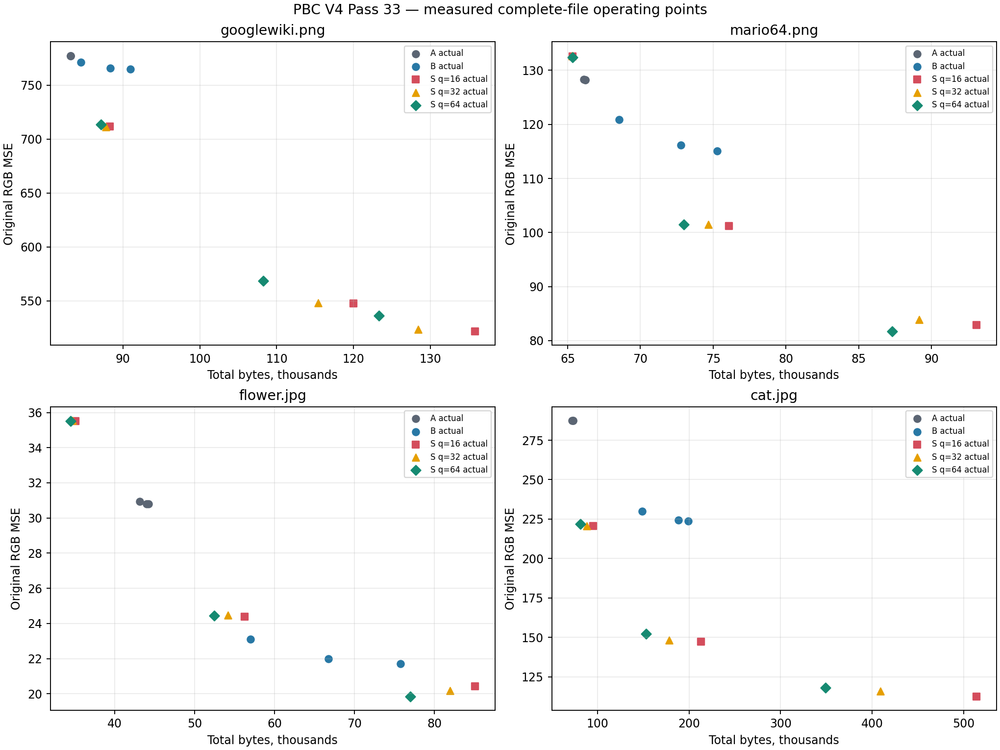
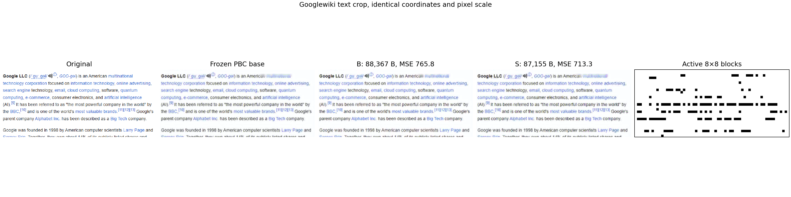

# PBC V4 Pass 33 — Sparse Original-Resolution Detail

## Result

The sparse 8×8 RGB DCT mode produced useful completed-file RD gains over Pass 31's interpolated-detail control on synthetic graphics and detailed photography, and on both conditional extension images. The initial four-image progression gate passed on Mario64 and Cat. The result is content-dependent: Googlewiki missed the 10% MSE threshold and smooth-photo Flower did not meet either gate. Sparse coding also raised encoder cost substantially, so this is architectural evidence for an optional detail mode, not a production recommendation.

All 90 final candidates decoded in independent fresh processes. The 36 A/B controls matched Pass 31 reconstruction and parameter behavior (24 checked against the frozen Pass 31 summary, 12 additional controls regenerated and compared directly). The eight codec tests pass.

## Representation and implementation

Each fixed 16×16 cell selects one mutually exclusive mode: SKIP, 3-channel DC, Pass 31's interpolated 4×4 detail, or sparse DCT. Sparse cells hold four independent 8×8 RGB blocks. Each block takes a type-II orthonormal 2D DCT-II over spatial axes, SciPy float64, one numerical worker. Signed original-minus-base residuals are transformed without clipping. Coefficients are rounded to qstep 16, 32, or 64; at most eight nonzero quantized coefficients per block are sent, across all three channels combined.

The encoder ranks a 16-coefficient shortlist by transform energy per emitted coefficient byte, then reranks it by exact single-coefficient RGB SSE gain after inverse basis application, pixel rounding, and clipping. It tests prefixes of up to eight ranked coefficients and chooses cell/block options with `J = exact SSE + λ × 8 × actual parameter bytes`. The parameter proxy excludes shared mode bits and XZ wrapper cost during local decisions; complete files are measured afterward. One shared XZ preset-6 stream contains the packed 3-bit-per-cell mode map and ordered parameter records. The fixed header is 31 bytes and signals dimensions, mode/cell constants, qstep, lengths, and stream version. No per-block entropy streams are used.

Decoder reconstructs only marked blocks into a 16×16 correction buffer, adds that to the frozen RGB base, then rounds and clips. It does not construct a full-resolution coefficient tensor. Partial right/bottom blocks are zero-padded for the forward transform and only valid pixels are applied. A/B semantics and mode IDs were held to Pass 31.

### Relation to earlier passes

- Pass 17 showed strong potential for full-resolution DCT sidecars on some graphics/text, but used a dense image transform and reported added decoder buffers and work; its separately compressed tile mode lost entropy context and generally failed RD.
- Pass 21 established sparse coefficient serialization and zero-run/zigzag lessons; this pass uses sparse local records but evaluates the representation's completed-file RD, not another entropy backend.
- Pass 22 reduced decoder work for its global transform format but retained dense coefficient/scatter/output structures and hundreds of MiB on Cat in its recorded prototype. Pass 33 changes the representation so unselected blocks are not transformed at decode time.
- Pass 31's interpolated detail is the direct B control; its reconstruction and serialization behavior were preserved.

## Provenance and protocol

The worktree was on `research/experiments` at expected starting HEAD `134869d949d7563691beaf89ce828ef5367306f4`. Source images, dimensions, frozen base-stream hashes, and decoded base hashes are recorded in the input manifest. Existing Pass 29–32 Quality bases were reused without regeneration. A/B controls use Pass 31's three lambdas `[0, 20, 100]`; S uses qsteps `[16, 32, 64]` and frozen lambdas `[100, 400, 1600]`.

A validity limitation must remain attached to these results: before calibration, an exploratory full four-image screen was run with sparse lambdas `[0, 20, 100]` and all four outcomes were viewed. A later Googlewiki-only q64 calibration showed that this screen did not span the A/B total-byte range. The final sparse lambdas were then frozen globally to `[100, 400, 1600]`, and all four images were rerun. No per-image lambda was selected. Because the first screen had already exposed the images, this is not an independent or blinded final screen; rate coverage drove the calibration adjustment. The two extension images were selected by the documented content rule after the primary gate and before encoding either extension image.

The two conditional images were Cathedral (masonry/arches/sculptural edges) and Park (irregular foliage plus a structured bridge). The selection record includes source and frozen-base hashes and dimensions.

## Completed-file RD

Total bytes include frozen base + full P33S enhancement, including its 31-byte header and shared XZ payload. MSE is computed from final decoded uint8 RGB pixels at original dimensions. Edge MSE is the top decile of Sobel magnitude; smooth MSE is the bottom half. All comparisons below are actual files; signed gaps are S relative to B. S points shown were selected from measured points within 5% rate where possible.

| Image / class | B total bytes / bpp / MSE | S total bytes / bpp / MSE | Rate gap | MSE gap | Edge MSE B → S | Smooth MSE B → S |
|---|---:|---:|---:|---:|---:|---:|
| Googlewiki, text/web | B λ100, 84,531 / 1.0231 / 771.24 | q32 λ1600, 87,811 / 1.0628 / 711.20 | +3.88% | −7.78% | 3385 → 3122 | 31.7 → 35.6 |
| Mario64, synthetic graphics | B λ20, 72,788 / 0.5850 / 116.13 | q16 λ400, 76,088 / 0.6116 / 101.18 | +4.53% | −12.87% | 885 → 694 | 18.6 → 27.0 |
| Flower, smooth photo | B λ0, 75,774 / 0.0711 / 21.71 | q64 λ100, 76,986 / 0.0722 / 19.85 | +1.60% | −8.60% | 124 → 101 | 9.45 → 9.87 |
| Cat, detailed photo | B λ100, 148,732 / 0.1396 / 229.84 | q64 λ400, 152,788 / 0.1434 / 152.29 | +2.73% | −33.74% | 713 → 319 | 63.2 → 51.8 |
| Cathedral, architecture (extension) | B λ20, 329,106 / 0.2195 / 246.91 | q64 λ400, 338,746 / 0.2259 / 185.02 | +2.93% | −25.07% | 1173 → 765 | 26.7 → 30.7 |
| Park, foliage/bridge (extension) | B λ20, 275,166 / 0.2581 / 208.04 | q32 λ400, 284,286 / 0.2667 / 174.14 | +3.31% | −16.29% | 992 → 730 | 18.4 → 22.9 |

Against DC-only A, the nearest-rate measured pairs were: Googlewiki 83,207 B / 777.25 MSE vs 87,155 B / 713.32 (S +4.74%, MSE −8.22%); Mario 66,108 / 128.30 vs 65,344 / 132.38 (−1.16%, +3.17%); Flower 44,218 / 30.80 vs 52,458 / 24.45 (+18.63%, −20.60%); Cat 73,116 / 287.29 vs 80,880 / 221.96 (+10.62%, −22.74%). These points show that S can add quality beyond DC, but at large rate increases on some images; it does not establish a generally better A frontier.

The initial gate requires at least two primary images with at least 10% lower MSE within 5% total bytes, or at least 10% fewer bytes within 5% MSE. It passed on Mario64 and Cat against B. The extension also passed on both selected images. Googlewiki and Flower did not meet either threshold. Flower is a real counterexample to broad generalization: its best within-5%-rate improvement over B was 8.60% MSE, below the gate.

The reconstruction panel shows the same Googlewiki crop in source/base/B/S at identical pixel scale plus the active-block map. The RD plot shows measured complete-file operating points for all primary images.

## Coefficient activity and frequency evidence

For the selected near-rate B comparisons, S used 1,297 active blocks / 6,670 coefficients on Mario, 28,047 / 154,233 on Cat, 44,567 / 258,860 on Cathedral, and 26,063 / 151,331 on Park. That corresponds to 8.3%, 21.1%, 23.7%, and 19.5% of all possible image 8×8 blocks. Mean transmitted coefficients per active block ranged from about 5.1 to 5.8, below the maximum of eight. Across the full S grids, active-block fractions ranged from 0.1% to 50.8%, depending on image and operating point.

On the four primary images, the selected coefficient share with diagonal frequency `u+v ≥ 4` was about 50.1% for the qualifying Mario q64 λ400 point, 8.2% for Cat q64 λ400, 10.3% for Flower q16 λ400, and 82.2% for Googlewiki q64 λ400. Text/graphics therefore carry substantial high-diagonal content, while photos mostly select lower frequencies. Cat's large edge-MSE drop and Mario's edge-MSE drop support recovery of detail around boundaries. Smooth-region error can rise even while global MSE falls (Mario, Googlewiki, Park, Cathedral). The gains are not solely high-frequency: this selection screen includes low-frequency coefficients and cannot causally separate low- and high-frequency contributions. A frequency-band ablation is still needed before claiming the gains are specifically due to high-frequency coding.

## Correctness, timing, and memory

All 90 measured complete files were independently decoded in fresh worker processes and matched recorded output pixel/mode/parameter hashes. All 36 A/B controls matched Pass 31 behavior. Eight tests pass for signed coefficients, packing boundaries, quantization, constants, sharp/text/gradient/clipping cases, odd/partial blocks, empty enhancement, malformed/duplicate/truncated data, active-block-only IDCT calls, and fresh-process file-only decoding. Floating DCT/IDCT uses Python 3.13.5, NumPy 2.2.6, SciPy float64 DCT-II, and one worker; exact agreement is demonstrated in this environment, not claimed across platforms or SciPy builds.

Encoding uses shared family analysis amortized over three lambda outputs plus median repeated complete serialization; it is not an isolated single-point encode time. Over all S rows, median amortized encode was 17.59 s (range 1.42–49.74 s); the tabled Mario/Cat/Cathedral/Park S points took 2.86, 23.03, 28.60, and 27.27 s. Across all 90 candidates, warmed decoder median was 0.347 s (range 0.004–3.763 s). The selected Mario, Cat, Cathedral, and Park points decoded in 0.043, 1.117, 1.974, and 1.063 s. These are single-thread Windows Python prototype measurements, not production or HF timings. Decoder IDCT calls were asserted equal to active blocks, but final correction/clipping still walks image cells.

Fresh decoder-process peak working set was 65.7–174.6 MB across the six images; per-image values and family buffer estimates are in the JSON summary. The encoder process high-water peak reached 821.7 MB after the largest images; it is cumulative, not a per-candidate increment. The decoder avoids the dense coefficient array structurally and its peaks are much lower than the recorded Pass 22 Cat prototype peak, but those separate prototypes are not controlled head-to-head memory benchmarks. Pass 33 therefore demonstrates sparse transform work, not a quantified memory ratio or production-ready runtime.

Complete accounting is saved for all rows: base/enhancement/total bytes, header and XZ bytes, raw mode/parameter payload, coefficient position/value bytes, block counts/masks, bpp, timing samples, hashes, mode counts, active cells/blocks, and frequency diagonals. The estimated local rate cost excludes the shared XZ stream's global effect, so local λ selection is a proxy; final RD conclusions use actual complete-file bytes.

## Required conclusions

**A. Sparse detail vs DC-only:** Sometimes. Text sees −8.22% MSE at +4.74% bytes; detailed photography sees −22.74% at +10.62% bytes; Mario is slightly worse MSE at nearly equal rate. It is not a generally superior DC replacement.

**B. Sparse detail vs Pass 31 detail:** Yes on Mario and Cat at the gate, and on both conditional images. Gains range from −12.87% to −33.74% MSE at +2.73% to +4.53% bytes on the two primary winners. Googlewiki and Flower miss the gate. The evidence supports an optional class-dependent representation.

**C. Are gains from original-resolution frequency detail?** Partly supported, not isolated. Edge MSE improves strongly on qualifying Mario/Cat; selected frequencies skew high on graphics/text. The photographic gains mostly use low diagonals, and no frequency-band ablation was run, so causation is not proven.

**D. Sparsity:** Between 0.1% and 50.8% of possible blocks across the S grid, with about 3.2–7.7 coefficients per active block and an eight-coefficient cap. At the two primary qualifying points, Mario activates 7.2% of blocks (1,122 / 15,552, 6,888 coefficients) and Cat 21.1%.

**E. Decoder and memory:** Decoder transforms only active blocks; a test verifies the call count. Fresh process peaks were 65.7–174.6 MB. This avoids the full-resolution coefficient tensor and is structurally better than the dense Pass 22 layout, but Python decode remains costly on large photographs, and cross-pass memory figures are not directly comparable.

**F. Image classes:** Best support is synthetic graphics and detailed photography; architecture and mixed foliage/bridge also pass the conditional gate. Text improves but below threshold. Smooth photography is weaker and does not pass. Smooth-region error rises on several mixed images.

**G. Future V4 combination:** Keep as a candidate optional detail mode paired with the low-resolution base for graphics, detailed photo, and architectural content. Do not generalize or integrate it yet: encoder cost is high, Flower misses, and the run's initial exploration/calibration caveat weakens independence.

**H. Limiting factor:** Not decoder reconstruction density or coefficient-count bounds. The dominant unresolved limits are selection/rate policy and content-dependent utility: the local cost proxy omits shared-XZ interactions, coefficient frequency utility varies by image class, and transform analysis is expensive. Signaling is explicit and fully measured, but current results do not identify it as the main failure.

## Recommendation

Preserve this pass as evidence for an optional sparse local-detail representation. The next research step should be a blinded, frozen-config validation on held-out content with a frequency-band ablation and measured shared-XZ marginal rate attribution. Do not broaden to the full benchmark or tune quantizers per image. If that validation fails, pursue a different representation rather than further transform-parameter tuning.