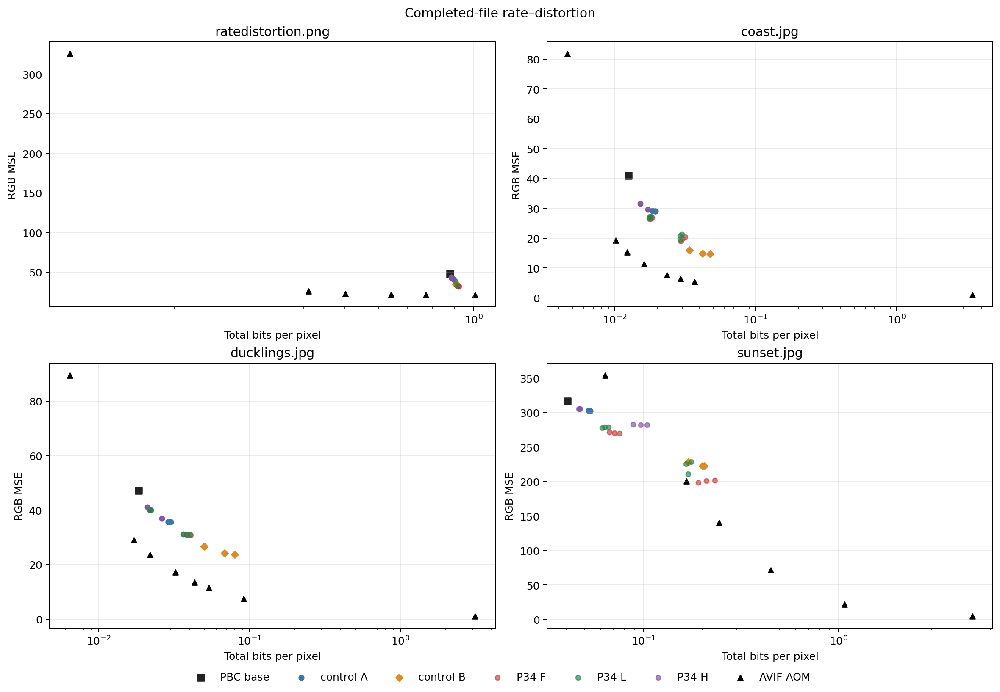
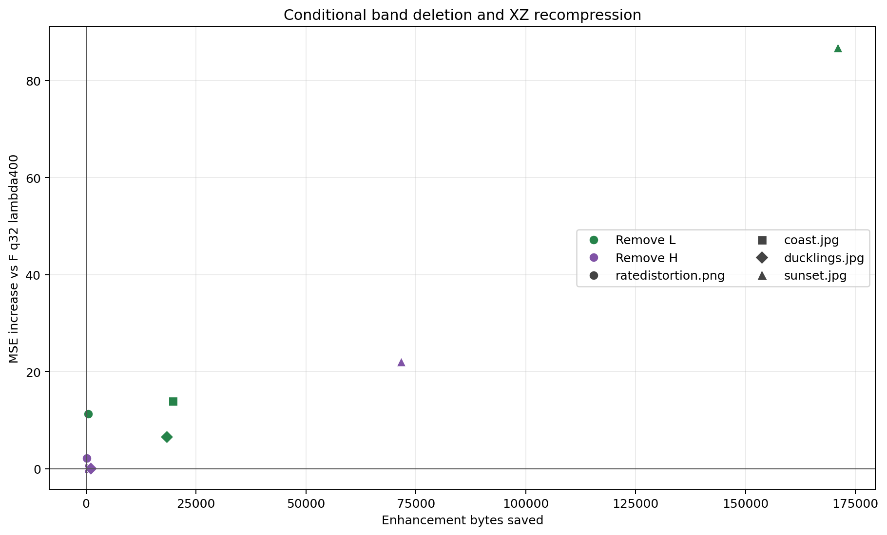
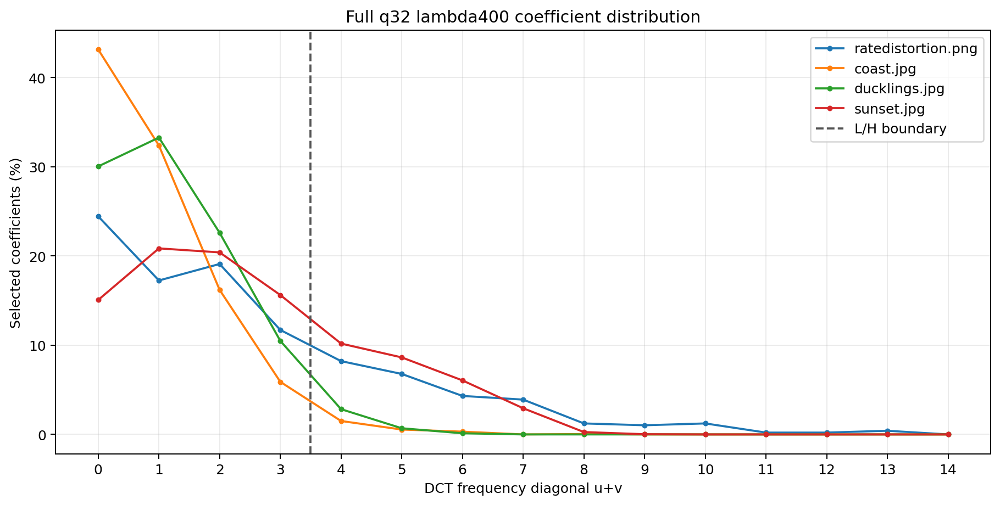

# PBC V4 — Research Pass 34

## Decision

Reject the sparse-frequency PBC variant as a release candidate. It reduces base error, but costs substantially more bytes on the photographic images, and fixed AVIF points beat its MSE at equal or lower completed-file size on all four images. Direct the next experiment to encoder-side AV1/libaom search and bit allocation. Keep production PBC unchanged. This is a four-image screen, not a population-level claim. No next pass is started automatically.

## Protocol

- Starting revision 39fe28e33bcff10d1d0481ec61f987c676ad9611, branch research/experiments. Image selection and SHA-256 values were frozen before enhancement runs in dataset_selection.json. All four are established hpt_data benchmark images; none was part of the Pass 33 sparse-transform screen, but they are not globally unseen.
- Each image used one PBC Quality base encoded through PBC3.compress with rng_mode=release and model SHA-256 ffaf24aa5447b3602c53a5c4c8df14a68ee16e6bded39331d973f38d0f1ea62f. The baseline is pinned to pbc31_release_rng_baseline at 8006f30debfc4a57289df06df21636aeb52baffd. Root pbc3_ops.py and pbc3_features.py include later semantics-preserving runtime kernels; see outputs/base_manifest.json.
- The fixed matrix contains 6 A/B controls per image (A/B × lambda 0, 20, 100) and 18 sparse candidates (F/L/H × q16/32/64 × lambda400/1600): 96 total. L accepts u+v<4; H accepts u+v>=4; F accepts all frequencies. Eligibility is filtered before ranking/shortlisting, and the signaled band is checked during decode.
- All 96 PBC streams passed fresh-process pixel, mode, and parameter hash checks. The eight conditional streams and each generated AVIF point also passed fresh-process decode. The A/B controls matched Pass 31 mode, parameter, and reconstruction hashes.
- MSE, edge-top-10% MSE, and smooth-bottom-50% MSE use the complete decoded base plus enhancement. Bpp uses finalized bytes divided by source pixels. Region masks use source Sobel magnitude.
- PBC encode time is shared family analysis amortized across two lambda outputs plus serialization amortized across outputs. Three decoder timings were sampled. Encoding was not repeated; these single-run times are exploratory and not deployment speed claims. Encoder peak working set sampled over the run: 1.57 GB.
- AVIF uses Pillow 11.3.0, libavif 1.3.0, libaom 3.12.1, speed 8, one thread, 4:2:0, full range. Up to four quality bisections bracket the PBC base size and fixed F q32 lambda400 total size. Sunset did not bracket the base target; the smallest tested AVIF file is reported.
- Environment: 3.13.5 (tags/v3.13.5:6cb20a2, Jun 11 2025, 16:15:46) [MSC v.1943 64 bit (AMD64)]; Windows-11-10.0.26200-SP0; NumPy 2.2.6, SciPy 1.16.2, Numba 0.62.1. OMP/OpenBLAS/MKL/NumExpr/Numba thread limits were one.

## Frozen images and base reconstruction

| Image | Dimensions | Prior use | Base bytes | Base MSE |
|---|---:|---|---:|---:|
| ratedistortion.png | 509×392 | Pass 10; Pass 11/12 set, chart/graphics | 21,959 | 47.43 |
| coast.jpg | 4240×2832 | Pass 10 benchmark | 18,717 | 40.88 |
| ducklings.jpg | 4240×2832 | Pass 10; Pass 11 RGB probe | 27,642 | 47.12 |
| sunset.jpg | 2832×4240 | Pass 10 benchmark | 61,132 | 316.46 |

## Sparse screen

The following four-image means give each image equal weight. Per-image detail for all 96 completed files is in PBC_V4_SPARSE_VALIDATION_SUMMARY.json.

| Band | q | lambda | Mean total bytes | Mean MSE | Edge MSE | Smooth MSE | Amortized encode seconds |
|---|---:|---:|---:|---:|---:|---:|---:|
| F | 16 | 400 | 120,032 | 71.15 | 295.06 | 12.12 | 38.09 |
| F | 16 | 1600 | 48,934 | 94.70 | 399.49 | 15.38 | 38.09 |
| F | 32 | 400 | 110,520 | 71.02 | 296.40 | 11.86 | 28.90 |
| F | 32 | 1600 | 47,184 | 94.94 | 400.77 | 15.34 | 28.90 |
| F | 64 | 400 | 102,048 | 70.11 | 299.63 | 11.40 | 22.29 |
| F | 64 | 1600 | 45,488 | 95.11 | 403.16 | 15.23 | 22.29 |
| L | 16 | 400 | 97,740 | 80.40 | 343.25 | 12.54 | 33.81 |
| L | 16 | 1600 | 45,378 | 97.47 | 416.95 | 15.56 | 33.81 |
| L | 32 | 400 | 93,002 | 78.76 | 338.32 | 12.17 | 27.63 |
| L | 32 | 1600 | 44,172 | 97.43 | 417.11 | 15.48 | 27.63 |
| L | 64 | 400 | 93,704 | 73.57 | 324.22 | 11.43 | 20.48 |
| L | 64 | 1600 | 43,366 | 96.74 | 414.96 | 15.31 | 20.48 |
| H | 16 | 400 | 60,952 | 97.55 | 422.52 | 14.72 | 23.96 |
| H | 16 | 1600 | 36,820 | 105.42 | 458.83 | 16.45 | 23.96 |
| H | 32 | 400 | 58,220 | 97.63 | 423.08 | 14.71 | 18.87 |
| H | 32 | 1600 | 36,694 | 105.43 | 458.85 | 16.44 | 18.87 |
| H | 64 | 400 | 54,972 | 97.67 | 424.95 | 14.72 | 15.06 |
| H | 64 | 1600 | 36,570 | 105.43 | 458.93 | 16.44 | 15.06 |

### Representative F q32 lambda400

| Image | Base bytes / MSE | PBC total bytes / MSE | bpp | AVIF below-rate point: q / bytes / MSE | AVIF above-rate point: q / bytes / MSE |
|---|---:|---:|---:|---|---|
| ratedistortion.png | 21,959 / 47.43 | 22,939 / 32.53 | 0.9197 | q93 / 19,298 / 21.06 | q100 / 25,121 / 21.11 |
| coast.jpg | 18,717 / 40.88 | 45,513 / 19.83 | 0.0303 | q43 / 43,855 / 6.30 | q50 / 55,075 / 5.41 |
| ducklings.jpg | 27,642 / 47.12 | 58,074 / 30.93 | 0.0387 | q25 / 48,441 / 17.22 | q31 / 64,936 / 13.53 |
| sunset.jpg | 61,132 / 316.46 | 315,556 / 200.80 | 0.2102 | q6 / 249,090 / 200.20 | q12 / 367,040 / 140.28 |

F q32 lambda400 lowers base MSE on all four, but adds 4.5% (ratedistortion), 143% (coast), 110% (ducklings), and 416% (sunset) to base bytes. q refinement is not monotonic in rate or MSE. The amortized F q32 lambda400 encoder times on the 4K photos were 23.33 s, 28.50 s, and 63.40 s; A control times were 1.13 s, 1.26 s, and 1.76 s.

### Conditional coefficient removal

Each counterfactual starts from the same completed F q32 lambda400 stream, removes a band, recalculates active cells/blocks, reserializes, and recompresses the shared XZ stream. These are conditional deltas, not independent band encodes.

| Image | Remove | Bytes saved | MSE increase | Blocks removed | Coefficients removed |
|---|---|---:|---:|---:|---:|
| ratedistortion.png | L | 476 | 11.28 | 18 | 353 |
| ratedistortion.png | H | 208 | 2.15 | 0 | 134 |
| coast.jpg | L | 19,784 | 13.92 | 3,302 | 16,270 |
| coast.jpg | H | 628 | 0.06 | 0 | 402 |
| ducklings.jpg | L | 18,364 | 6.60 | 3,363 | 15,184 |
| ducklings.jpg | H | 1,060 | 0.12 | 13 | 575 |
| sunset.jpg | L | 171,020 | 86.73 | 13,631 | 149,916 |
| sunset.jpg | H | 71,616 | 21.99 | 1,107 | 58,538 |

Removing L creates the larger MSE loss on all four images. Removing H is near-neutral on coast and ducklings, but increases sunset MSE by 22.0. This is useful diagnostic evidence for the low/high split, but does not reverse the AVIF comparison.

### Exact stream accounting: F q32 lambda400

XZ compresses the raw fields jointly, so savings are not assigned to individual fields.

| Image | Header | Raw payload | XZ payload | XZ minus raw | Enhancement bytes | Blocks | Coefficients |
|---|---:|---:|---:|---:|---:|---:|---:|
| ratedistortion.png | 32 | 1,459 | 948 | -511 | 980 | 78 | 487 |
| coast.jpg | 32 | 70,763 | 26,764 | -43,999 | 26,796 | 3,614 | 16,672 |
| ducklings.jpg | 32 | 83,004 | 30,400 | -52,604 | 30,432 | 3,720 | 15,759 |
| sunset.jpg | 32 | 501,568 | 254,392 | -247,176 | 254,424 | 34,438 | 208,454 |

## AVIF comparison

Both neighboring AVIF points beat PBC MSE on each representative F q32 lambda400 file. On sunset, AVIF q6 is 21.1% smaller and slightly lower MSE; q12 is larger and much lower MSE. AVIF brackets the PBC base size for ratedistortion, coast, and ducklings. Sunset q0 is 95,484 bytes, above its 61,132-byte base target, so that target was not bracketed.

AVIF stores AV1 images in HEIF. libavif provides the format library and tools; libaom documents partition/mode/transform rate-distortion search. [AVIF spec](https://aomediacodec.github.io/av1-avif/v1.2.0.html), [libavif](https://aomedia.googlesource.com/libavif/), [libaom encoder guide](https://aomedia.googlesource.com/aom/+/refs/heads/main/doc/dev_guide/av1_encoder.dox).

## Figures

## Transition strategy

Do not continue the PBC sparse-transform codec path. Start the next experiment inside an AV1 encoder, preserving ordinary AVIF output and decoder compatibility. AV1 encoders already search and prune partitions, prediction modes, transforms, and rate-distortion candidates.

1. **PBC-feature-guided AV1 candidate pruning.** Feed cheap residual-frequency and edge summaries into libaom intra partition/mode/transform candidate ranking. Compare against libaom statistical, ML, and estimated-cost pruning at matched rate and speed. Evidence gap: libaom already has these pruning methods, so PBC features must demonstrate a net gain without hiding RD losses. [libaom encoder guide](https://aomedia.googlesource.com/aom/+/refs/heads/main/doc/dev_guide/av1_encoder.dox).

2. **PBC residual diagnostics for AV1 adaptive quantization.** Use smooth/edge and low/high residual measurements to propose AQ or segment weights, while libaom still emits all AV1 syntax. Validate matched file size, edge and smooth errors, and the existing 20-image main plus 5-image holdout. Evidence gap: conditional band value varied by image, so averaged MSE may hide local damage. [AV1 tool description](https://aomedia.org/docs/AV1_ToolDescription_v11-clean.pdf).

3. **Content-aware selection of AV1 speed and quality settings.** Use image-level PBC analysis to select existing libaom speed features and quantizer/RDO settings. Gate on lower one-thread encode time without worse rate-distortion on the main and holdout sets. This changes encoder decisions only, not the stream.
Keep WebP and JPEG XL as separately measured conventional baselines: WebP uses prediction, residual transforms, quantization, and entropy coding; JPEG XL uses adaptive quantization and transform residuals. [WebP compression guide](https://developers.google.com/speed/webp/docs/compression), [JPEG XL format overview](https://github.com/libjxl/libjxl/blob/main/doc/xl_overview.md).

Keep learned codecs as an independent architecture track. Apple PICO and Microsoft PULSE use their own model/decoder stacks and are not AVIF integrations. PICO documents Apple Sample Code License for code and CC-BY-NC-ND for shared study data; GenCodec/PULSE documents MIT licensing and model-dependent .pulse files. Pin code and model revisions and compare them with equal images, rates, metrics, and CPU limits. [PICO](https://github.com/apple-aiml-research/ml-pico), [PULSE](https://github.com/microsoft/GenCodec/tree/main/PULSE), [PULSE paper](https://arxiv.org/abs/2609.18602).

## Validation and limits

- PBC34 tests: 8 passed. Pass33 regression tests: 8 passed.
- All 96 PBC candidates, 8 conditional streams, and every generated AVIF point passed fresh-process decoding. The PBC full spectrum matches Pass 33 exactly under tests.
- AVIF quality q is not a cross-codec quality scale; comparisons use final bytes and decoded RGB MSE. No subjective study or perceptual metric was run.
- Four images are too few for a population-level result; three have prior general benchmark use. Encoder timings were one-run samples and are not deployment claims.
- No production, model, or HF Space files changed. No follow-on research pass was started.
